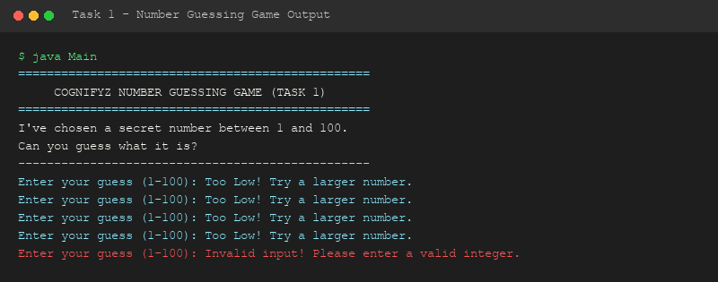

# Level 1 - Task 1: Basic Text-Based Game (Number Guessing Game)

**Cognifyz Technologies - Software Development Internship**

---

## 📌 Overview
Task 1 involves developing a console-based game to demonstrate fundamental programming logic, control flow structures (`if-else` branching, `while` loops), standard output formatting, and user input validation in Java.

---

## 🎯 Objectives & Requirements
- **Game Selected**: Number Guessing Game.
- **Rules**:
  1. The computer selects a random secret number between 1 and 100.
  2. The user attempts to guess the number.
  3. The application provides immediate directional feedback: `"Too High!"`, `"Too Low!"`, or `"Correct!"`.
  4. Tracks total attempts taken and prints a final skill performance rating.

---

## 🔑 Java Concepts Demonstrated
- **Conditionals**: `if`, `else if`, `else`
- **Looping**: `while (!guessedCorrectly)`
- **Input Processing**: `java.util.Scanner`
- **Randomization**: `java.util.Random`

---

## 🛠️ How to Compile & Run

```bash
# Navigate to project directory
cd Level-1/Task-1-Text-Based-Game/src

# Compile Java source
javac Main.java

# Execute application
java Main
```

---

## 📷 Output Demonstration


