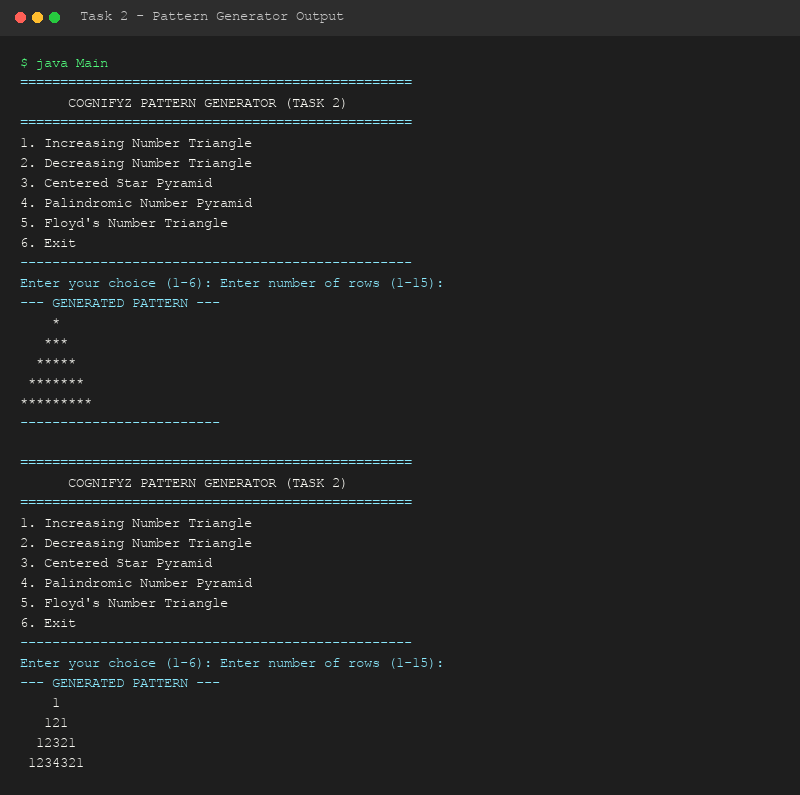

# Level 1 - Task 2: Number & Star Pattern Generator

**Cognifyz Technologies - Software Development Internship**

---

## 📌 Overview
Task 2 focuses on mastering nested loops (`for` loops), row-column indexing, and formatted output generation by constructing structured geometric number and star patterns based on customizable user parameters.

---

## 🎯 Supported Patterns
1. **Increasing Number Triangle** (`1`, `1 2`, `1 2 3`, ...)
2. **Decreasing Number Triangle** (`1 2 3 4 5`, `1 2 3 4`, ...)
3. **Centered Star Pyramid** (`*`, `***`, `*****`, ...)
4. **Palindromic Number Pyramid** (`1`, `121`, `12321`, ...)
5. **Floyd's Number Triangle** (`1`, `2 3`, `4 5 6`, ...)

---

## 🔑 Java Concepts Demonstrated
- **Nested Loops**: Outer loops control rows; inner loops control column counters and spaces.
- **Switch Statements**: Select pattern type based on user choice.
- **Input Constraints**: Validation for row boundaries (1 to 20).

---

## 🛠️ How to Compile & Run

```bash
# Navigate to source directory
cd Level-1/Task-2-Number-Patterns/src

# Compile Java source
javac Main.java

# Execute application
java Main
```

---

## 📷 Output Demonstration


