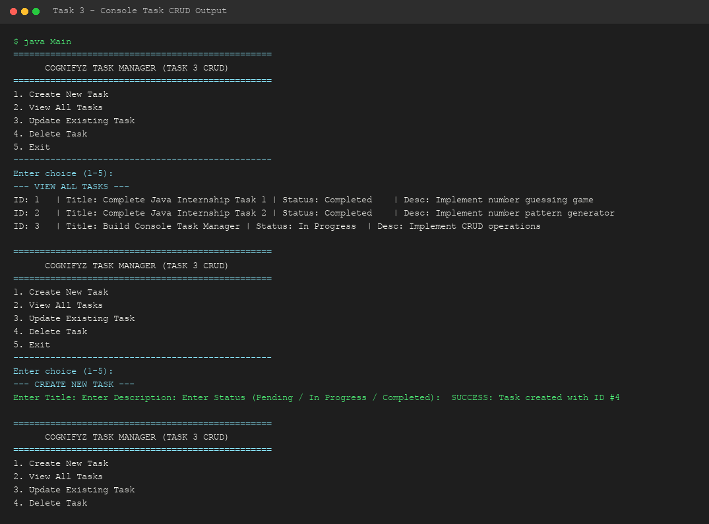

# Level 2 - Task 3: Console CRUD Task Manager

**Cognifyz Technologies - Software Development Internship**

---

## 📌 Overview
Task 3 is an intermediate software engineering task requiring the design of an Object-Oriented Console Application implementing full CRUD (Create, Read, Update, Delete) lifecycle management for tasks using Java collection data structures.

---

## 🏗️ Architecture & Class Structure
- **`Task.java`**: Domain model encapsulating task attributes (`id`, `title`, `description`, `status`) with getters/setters and custom string formatting.
- **`TaskManager.java`**: Data access service encapsulating an `ArrayList<Task>` for storing, updating, searching, and deleting task records.
- **`Main.java`**: Interactive CLI wrapper with menu options and exception handling.

---

## 🔑 Java Concepts Demonstrated
- **Object-Oriented Programming (OOP)**: Encapsulation, abstraction, class design.
- **Java Collections Framework**: Dynamic list management via `ArrayList<Task>`.
- **CRUD Operations**:
  - `C` (Create): `addTask()`
  - `R` (Read): `getAllTasks()`, `getTaskById()`
  - `U` (Update): `updateTask()`
  - `D` (Delete): `deleteTask()`

---

## 🛠️ How to Compile & Run

```bash
# Navigate to source directory
cd Level-2/Task-3-CRUD-Task-Manager/src

# Compile all class files
javac *.java

# Execute main program
java Main
```

---

## 📷 Output Demonstration


