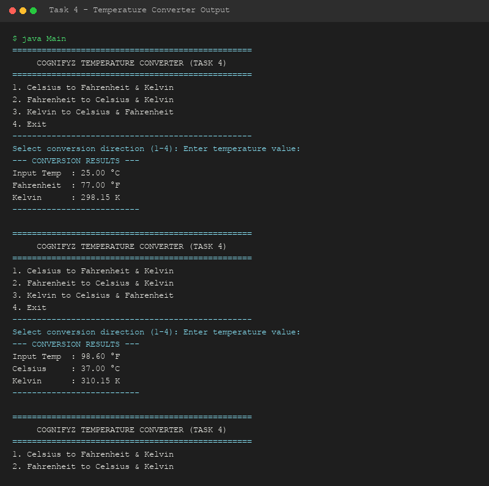

# Level 2 - Task 4: Temperature Converter Program

**Cognifyz Technologies - Software Development Internship**

---

## 📌 Overview
Task 4 requires building a comprehensive temperature conversion tool allowing users to convert values seamlessly across Celsius (°C), Fahrenheit (°F), and Kelvin (K) scales with strict mathematical accuracy and input validation.

---

## 🧮 Mathematical Formulas Implemented
- **Celsius to Fahrenheit**: $F = (C \times \frac{9}{5}) + 32$
- **Celsius to Kelvin**: $K = C + 273.15$
- **Fahrenheit to Celsius**: $C = (F - 32) \times \frac{5}{9}$
- **Fahrenheit to Kelvin**: $K = (F - 32) \times \frac{5}{9} + 273.15$
- **Kelvin to Celsius**: $C = K - 273.15$

---

## 🔑 Java Concepts Demonstrated
- **Arithmetic Methods**: Double-precision floating point calculations (`printf` string formatting).
- **Control Logic**: Direction selection via `switch-case`.
- **Absolute Zero Handling**: Boundary checks for physical temperature limits ($0\text{ K}$).

---

## 🛠️ How to Compile & Run

```bash
# Navigate to source directory
cd Level-2/Task-4-Temperature-Converter/src

# Compile Java source
javac Main.java

# Execute application
java Main
```

---

## 📷 Output Demonstration


