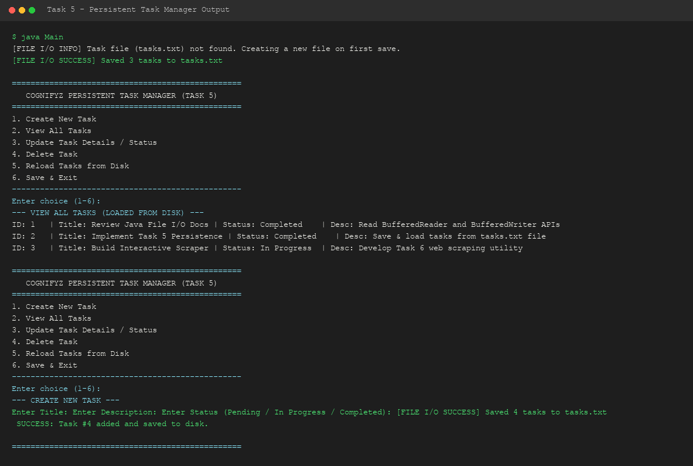

# Level 3 - Task 5: Persistent Task Manager Using File I/O

**Cognifyz Technologies - Software Development Internship**

---

## 📌 Overview
Task 5 enhances the in-memory Task 3 CRUD application into a robust enterprise-ready persistent task manager. Task data is stored on disk inside `tasks.txt` using a pipe-delimited format (`|`), persisting state across program restarts.

---

## 🏗️ Persistence Architecture
- **`Task.java`**: Includes `toFileFormat()` and `fromFileFormat()` methods for string serialization/deserialization.
- **`TaskFileManager.java`**: Implements file read/write logic using `BufferedReader` and `BufferedWriter`, handling missing file initialization and `IOException` recovery.
- **`tasks.txt`**: Plaintext storage file maintaining task state between application sessions.
- **`Main.java`**: Full persistent CRUD CLI interface with disk synchronization.

---

## 🔑 Java Concepts Demonstrated
- **Java File I/O**: `java.io.File`, `java.io.FileReader`, `java.io.FileWriter`, `java.io.BufferedReader`, `java.io.BufferedWriter`.
- **Exception Handling**: `try-with-resources`, `IOException` handling.
- **Data Persistence**: Serialization of object state into structured delimited text files.

---

## 🛠️ How to Compile & Run

```bash
# Navigate to source directory
cd Level-3/Task-5-Persistent-Task-Manager/src

# Compile Java source files
javac *.java

# Execute application
java Main
```

---

## 📷 Output Demonstration


