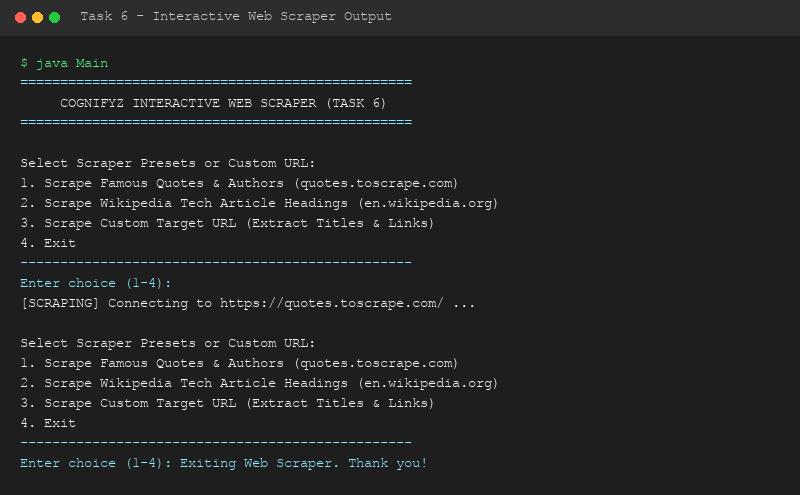

# Level 3 - Task 6: Interactive Web Scraper Program

**Cognifyz Technologies - Software Development Internship**

---

## 📌 Overview
Task 6 is an advanced software application that connects to real-world external websites via HTTP requests, retrieves raw HTML data, parses DOM elements, and presents extracted information (titles, quotes, authors, section headers, hyperlinks) in a clean, user-friendly terminal output format.

---

## 🌐 Supported Scraping Targets
1. **Quotes to Scrape (`quotes.toscrape.com`)**: Scrapes famous quotes and their respective authors.
2. **Wikipedia Tech Article (`en.wikipedia.org`)**: Scrapes section headers from the Java programming article.
3. **Custom Target URL**: Allows user to input any website URL to extract page title and hyperlinks.

---

## 🔑 Java Concepts Demonstrated
- **Networking**: `java.net.HttpURLConnection`, `java.net.URI`, `java.net.URL`.
- **Regular Expressions**: `java.util.regex.Pattern`, `java.util.regex.Matcher` for HTML parsing.
- **HTTP Handling**: Setting custom `User-Agent`, handling response status codes (HTTP 200), stream reader buffers.

---

## 🛠️ How to Compile & Run

```bash
# Navigate to source directory
cd Level-3/Task-6-Web-Scraper/src

# Compile Java source
javac Main.java

# Execute application
java Main
```

---

## 📷 Output Demonstration


